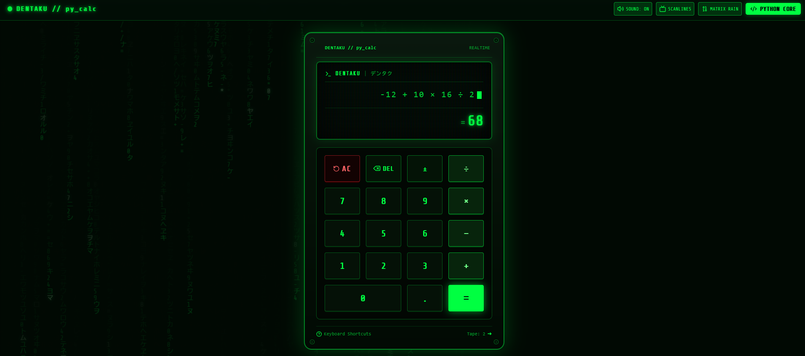

# AI Software Engineering Immersion · Alura + Google

[English](#english) · [Português](#português)



## English

This repository brings together the projects developed during the **Software Engineering Immersion: Dev in the Age of AI**, hosted by Alura in partnership with Google. Each project lives in its own folder.

### Project 01 — DENTAKU

[DENTAKU](./calculadora/) is the **first project developed in the course**: a calculator with a Python calculation engine and a web interface built around a **terminal aesthetic inspired by Matrix**.

The name comes from **dentaku (電卓 / デンタク)**, which means **calculator in Japanese**. Its visual identity combines glowing green text, a dark background, monospaced typography, CRT-style scanlines, and digital rain to recreate the atmosphere of a retro terminal.

The calculator supports addition, subtraction, multiplication, and division. The project combines **Python** for calculations, **React and TypeScript** for the interface, and **Node.js, Express, and Vite** for the web application.

### Run locally

For the web application, install Node.js/npm and make sure Python 3 is available as `python3` on your PATH. From the repository root, run:

```sh
cd calculadora
npm install
npm run dev
```

Open [localhost:3000](http://localhost:3000) in your browser.

To use only the Python calculator, run this from inside `calculadora/`:

```sh
python3 calculator.py
```

On Windows, you can use `python calculator.py` for the command-line version if that is your Python command. The web server currently invokes `python3`.

Run `npm run build` to build the web interface and `npm run lint` to check TypeScript. Run both commands inside `calculadora/`. For hosting or external tools, set the application root directory to `calculadora/`.

Future projects will be added in their own folders alongside `calculadora/`.

---

## Português

Este repositório reúne os projetos desenvolvidos durante a **Imersão Engenharia de Software: Dev na Era da IA**, promovida pela Alura em parceria com o Google. Cada projeto fica em sua própria pasta.


### Projeto 01 — DENTAKU

O [DENTAKU](./calculadora/) é o **primeiro projeto desenvolvido no curso**: uma calculadora com motor de cálculo em Python e interface web construída com uma **estética de terminal inspirada em Matrix**.

O nome vem de **dentaku (電卓 / デンタク)**, que significa **calculadora em japonês**. A identidade visual combina texto verde luminoso, fundo escuro, tipografia monoespaçada, linhas de varredura de monitores CRT e chuva digital para recriar a atmosfera de um terminal retrô.

A calculadora oferece adição, subtração, multiplicação e divisão. O projeto combina **Python** para os cálculos, **React e TypeScript** para a interface e **Node.js, Express e Vite** para a aplicação web.

### Executar localmente

Para usar a aplicação web, instale Node.js/npm e certifique-se de que o Python 3 está disponível no PATH pelo comando `python3`. A partir da raiz do repositório, execute:

```sh
cd calculadora
npm install
npm run dev
```

Abra [localhost:3000](http://localhost:3000) no navegador.

Para usar apenas a calculadora em Python, execute dentro de `calculadora/`:

```sh
python3 calculator.py
```

No Windows, você pode usar `python calculator.py` para a versão de terminal, caso esse seja o comando da sua instalação. O servidor web atualmente utiliza `python3`.

Use `npm run build` para gerar a interface web de produção e `npm run lint` para verificar o TypeScript. Execute ambos dentro de `calculadora/`. Ao configurar hospedagem ou ferramentas externas, defina `calculadora/` como diretório raiz da aplicação.

Os próximos projetos serão adicionados em pastas próprias, ao lado de `calculadora/`.
